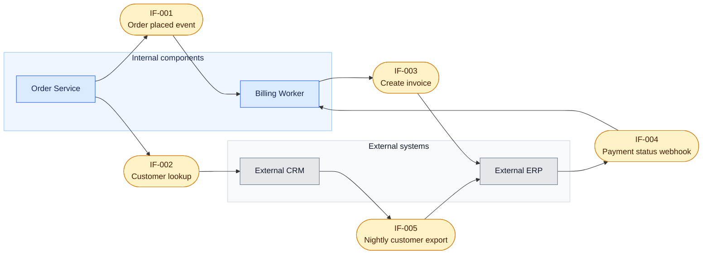

<!-- Generated by scripts/generate.py; edit catalog/catalog.json instead. -->

# Integration Atlas — Mermaid cross-reference demo

A small documentation-as-code proof of concept: **two internal components, two external systems, five interfaces**.
All systems, owners, contracts, and versions are fictional examples.

**Start here:** click a yellow **IF-xxx** node to open its interface page, then follow its versioned contract artifact.
Click a blue or gray system node to see every incoming and outgoing interface.
The link table below provides the same navigation in any Markdown viewer.

## Integration landscape



Each yellow node represents a connection, not an extra running component. Arrows follow the primary request or data flow;
HTTP responses are implicit. IF-005 connects the two external systems directly.
Mermaid supports node hyperlinks; ordinary flowchart edges do not provide the same `click` directive.
The interface node makes every connection individually addressable.

## Interface catalog

| Interface | Source → target | Protocol | Deployed version | Contract artifact |
| --- | --- | --- | --- | --- |
| [IF-001 — Order placed event](docs/interfaces/IF-001.md) | [Order Service](docs/systems/order-service.md) → [Billing Worker](docs/systems/billing-worker.md) | AMQP / JSON | 1.0.0 | [JSON Schema](contracts/orders/order-placed-1.0.0.schema.json) |
| [IF-002 — Customer lookup](docs/interfaces/IF-002.md) | [Order Service](docs/systems/order-service.md) → [External CRM](docs/systems/crm.md) | HTTPS / REST / JSON | 1.4.0 | [OpenAPI 3.1](contracts/crm/customer-api-1.4.0.openapi.json) |
| [IF-003 — Create invoice](docs/interfaces/IF-003.md) | [Billing Worker](docs/systems/billing-worker.md) → [External ERP](docs/systems/erp.md) | HTTPS / REST / JSON | 2.1.0 | [OpenAPI 3.1](contracts/erp/invoices-2.1.0.openapi.json) |
| [IF-004 — Payment status webhook](docs/interfaces/IF-004.md) | [External ERP](docs/systems/erp.md) → [Billing Worker](docs/systems/billing-worker.md) | HTTPS / webhook / JSON | 1.2.0 | [JSON Schema](contracts/erp/payment-status-1.2.0.schema.json) |
| [IF-005 — Nightly customer export](docs/interfaces/IF-005.md) | [External CRM](docs/systems/crm.md) → [External ERP](docs/systems/erp.md) | SFTP / UTF-8 CSV | 3.0.0 | [CSV data dictionary](contracts/customer-export/customer-export-3.0.0.md) |

## Try the cross-references

1. Open [IF-003](docs/interfaces/IF-003.md): check deployed version **2.1.0** and open its OpenAPI artifact.
2. Follow its **Billing Worker** link: see both outgoing invoice calls and incoming events/webhooks.
3. Open [IF-005](docs/interfaces/IF-005.md): inspect the external CRM → ERP connection and its CSV contract.
4. Use the diagram nodes above and the table links to compare navigation in GitHub's renderer.
5. Follow [the review checklist](docs/review-checklist.md) to assess the approach in your own viewer.

## Maintain the repository

The [catalog](catalog/catalog.json) is the source for IDs, endpoints, deployed versions, owners, and operational notes.
The [versioned contracts](contracts/) contain the actual interface documentation artifacts.
The generator creates this README, the [reusable Mermaid source](docs/landscape.mmd), interface pages, and system backlinks.

```sh
python3 scripts/generate.py
python3 scripts/generate.py --check
```

Python 3.11+; no third-party dependencies. CI runs the check on pushes and pull requests.
It checks references, artifact versions, generated-file drift, and repository-local link destinations.
It does not validate a live deployment or perform full OpenAPI/JSON Schema conformance validation.

Read [the repository structure and tradeoffs](docs/approach.md) before adapting the demo.
See [verification results](docs/verification.md) for the checks performed on this proof of concept.
Native Mermaid click behavior depends on the hosting renderer; the Markdown table remains available.
