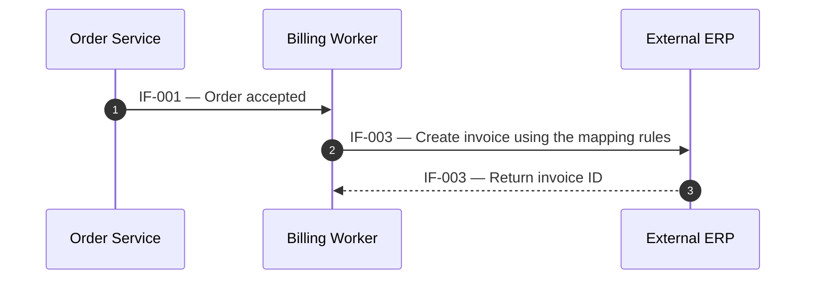
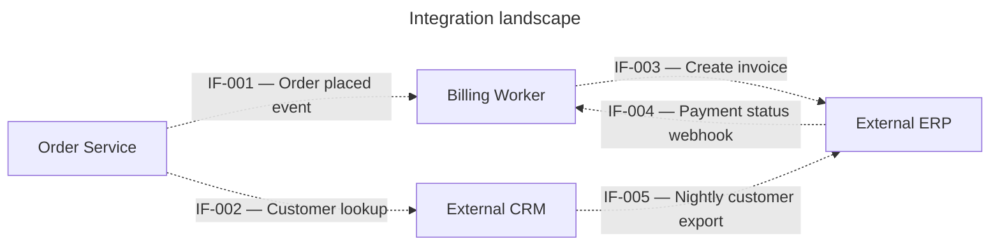
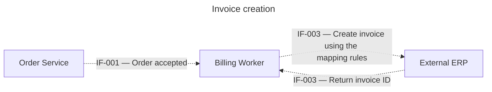
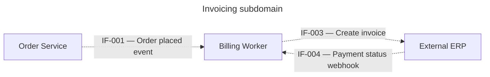

<!-- Generated by npm run build. Do not edit on the rendered branch. -->
# LikeC4 — rendered demonstration

[Source used for this build](https://github.com/benedikt-roth/integration-atlas-demo/tree/f4d63fa29db527a70a659547b7c72a92caaa22b7/likec4-poc) ·
[Download the interactive HTML](index.html?raw=true)

This page renders directly in GitHub. It is generated after the LikeC4 build and
published here automatically when the build on `main` succeeds. The native
LikeC4-exported diagrams appear below, followed by the shared interface catalog.

For the full interactive viewer, download `index.html`, or clone this branch and
serve its directory with `python3 -m http.server 3000`. Open the local address
printed by that server. The HTML contains the application's scripts and styles;
the standalone file was also tested over a local HTTP server.

## Invoice creation — numbered flow

From an accepted order to a confirmed ERP invoice, with linked mapping rules and an explicit response.

### Annotations and interface references

| Step | Source → target | Annotation | Interface | Deployed version | Contract artifact |
| --- | --- | --- | --- | --- | --- |
| 1 | [Order Service](https://github.com/benedikt-roth/integration-atlas-demo/blob/main/docs/systems/order-service.md) → [Billing Worker](https://github.com/benedikt-roth/integration-atlas-demo/blob/main/docs/systems/billing-worker.md) | Order accepted | [IF-001](https://github.com/benedikt-roth/integration-atlas-demo/blob/main/docs/interfaces/IF-001.md) | 1.0.0 | [JSON Schema](https://github.com/benedikt-roth/integration-atlas-demo/blob/main/contracts/orders/order-placed-1.0.0.schema.json) |
| 2 | [Billing Worker](https://github.com/benedikt-roth/integration-atlas-demo/blob/main/docs/systems/billing-worker.md) → [External ERP](https://github.com/benedikt-roth/integration-atlas-demo/blob/main/docs/systems/erp.md) | [Create invoice using the mapping rules](https://github.com/benedikt-roth/integration-atlas-demo/blob/main/docs/notes/invoice-mapping.md) | [IF-003](https://github.com/benedikt-roth/integration-atlas-demo/blob/main/docs/interfaces/IF-003.md) | 2.1.0 | [OpenAPI 3.1](https://github.com/benedikt-roth/integration-atlas-demo/blob/main/contracts/erp/invoices-2.1.0.openapi.json) |
| 3 | [External ERP](https://github.com/benedikt-roth/integration-atlas-demo/blob/main/docs/systems/erp.md) → [Billing Worker](https://github.com/benedikt-roth/integration-atlas-demo/blob/main/docs/systems/billing-worker.md) | Return invoice ID | [IF-003](https://github.com/benedikt-roth/integration-atlas-demo/blob/main/docs/interfaces/IF-003.md) | 2.1.0 | [OpenAPI 3.1](https://github.com/benedikt-roth/integration-atlas-demo/blob/main/contracts/erp/invoices-2.1.0.openapi.json) |

## Native LikeC4 diagram exports

<!-- Generated by likec4 export markdown. Do not edit manually. -->

### Integration landscape

The same 4 systems and 5 interfaces as the Mermaid POC. Select a relationship to inspect its metadata and documentation links.

### Invoice creation

From an accepted order to a confirmed ERP invoice, with linked mapping rules and an explicit response.

### Invoicing subdomain

Order events, invoice creation, and payment updates, without implying an execution sequence.

## Shared interface catalog

| Interface | Source → target | Protocol | Deployed version | Contract artifact |
| --- | --- | --- | --- | --- |
| [IF-001 — Order placed event](https://github.com/benedikt-roth/integration-atlas-demo/blob/main/docs/interfaces/IF-001.md) | [Order Service](https://github.com/benedikt-roth/integration-atlas-demo/blob/main/docs/systems/order-service.md) → [Billing Worker](https://github.com/benedikt-roth/integration-atlas-demo/blob/main/docs/systems/billing-worker.md) | AMQP / JSON | 1.0.0 | [JSON Schema](https://github.com/benedikt-roth/integration-atlas-demo/blob/main/contracts/orders/order-placed-1.0.0.schema.json) |
| [IF-002 — Customer lookup](https://github.com/benedikt-roth/integration-atlas-demo/blob/main/docs/interfaces/IF-002.md) | [Order Service](https://github.com/benedikt-roth/integration-atlas-demo/blob/main/docs/systems/order-service.md) → [External CRM](https://github.com/benedikt-roth/integration-atlas-demo/blob/main/docs/systems/crm.md) | HTTPS / REST / JSON | 1.4.0 | [OpenAPI 3.1](https://github.com/benedikt-roth/integration-atlas-demo/blob/main/contracts/crm/customer-api-1.4.0.openapi.json) |
| [IF-003 — Create invoice](https://github.com/benedikt-roth/integration-atlas-demo/blob/main/docs/interfaces/IF-003.md) | [Billing Worker](https://github.com/benedikt-roth/integration-atlas-demo/blob/main/docs/systems/billing-worker.md) → [External ERP](https://github.com/benedikt-roth/integration-atlas-demo/blob/main/docs/systems/erp.md) | HTTPS / REST / JSON | 2.1.0 | [OpenAPI 3.1](https://github.com/benedikt-roth/integration-atlas-demo/blob/main/contracts/erp/invoices-2.1.0.openapi.json) |
| [IF-004 — Payment status webhook](https://github.com/benedikt-roth/integration-atlas-demo/blob/main/docs/interfaces/IF-004.md) | [External ERP](https://github.com/benedikt-roth/integration-atlas-demo/blob/main/docs/systems/erp.md) → [Billing Worker](https://github.com/benedikt-roth/integration-atlas-demo/blob/main/docs/systems/billing-worker.md) | HTTPS / webhook / JSON | 1.2.0 | [JSON Schema](https://github.com/benedikt-roth/integration-atlas-demo/blob/main/contracts/erp/payment-status-1.2.0.schema.json) |
| [IF-005 — Nightly customer export](https://github.com/benedikt-roth/integration-atlas-demo/blob/main/docs/interfaces/IF-005.md) | [External CRM](https://github.com/benedikt-roth/integration-atlas-demo/blob/main/docs/systems/crm.md) → [External ERP](https://github.com/benedikt-roth/integration-atlas-demo/blob/main/docs/systems/erp.md) | SFTP / UTF-8 CSV | 3.0.0 | [CSV data dictionary](https://github.com/benedikt-roth/integration-atlas-demo/blob/main/contracts/customer-export/customer-export-3.0.0.md) |

## Demo notes

The interactive viewer exposes references through its step notes. LikeC4 1.60.0
has a known reverse-step association issue in this example: the return arrow's
native relationship lookup selects IF-004. The explicit canonical links above
and in step notes correctly reference IF-003. See the
[evaluation finding](https://github.com/benedikt-roth/integration-atlas-demo/blob/main/likec4-poc/README.md#evaluation-finding-reverse-step-relationship-matching).

All interface definitions and scenario steps are maintained in the source
catalog. This branch contains generated build output.

