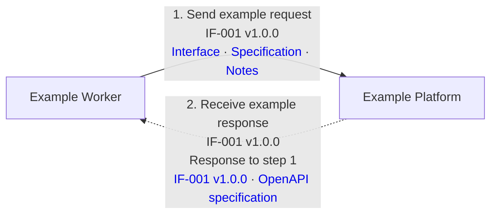
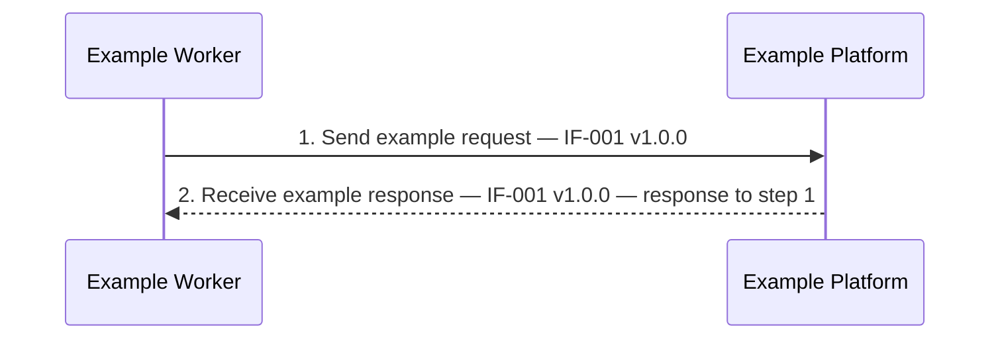

<!-- Generated by scripts/atlas.py; edit the corresponding view JSON file. -->

# VIEW-001 — Example request

[Catalog](../index.md)

A minimal request and explicit response. Both representations use this one step list.

## Component view

## Sequence

Message links are available in the table below. A routed step expands into
physical hops labeled `1a`, `1b`, etc.; both retain the same logical step.

## Interface usages

| Scenario | Step | From → to | Interface | Version | Target payload | Envelope | Response to | Annotation | References |
| --- | --- | --- | --- | --- | --- | --- | --- | --- | --- |
| [Example request](VIEW-001.md) | 1 | [Example Worker](../components/CMP-001.md) → [Example Platform](../systems/SYS-001.md) | [IF-001](../interfaces/IF-001.md) | 1.0.0 | IF-001 v1.0.0 | — | — | Send example request | [Interface](../interfaces/IF-001.md) · [Specification](../../../contracts/example-api-1.0.0.openapi.json) · [Notes](../../notes/example.md) |
| [Example request](VIEW-001.md) | 2 | [Example Platform](../systems/SYS-001.md) → [Example Worker](../components/CMP-001.md) | [IF-001](../interfaces/IF-001.md) | 1.0.0 | IF-001 v1.0.0 | — | 1 | Receive example response | [IF-001 v1.0.0](../interfaces/IF-001.md) · [OpenAPI specification](../../../contracts/example-api-1.0.0.openapi.json) |

