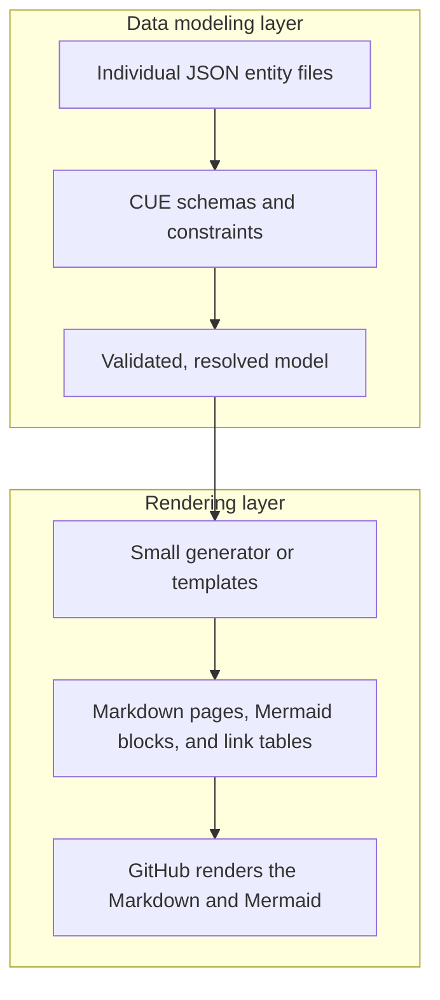

# Solution architecture

[Back to the landscape](../README.md) · [Current POC implementation](approach.md)

Status: agreed target architecture, recorded on 2026-11-15. We are in the design
phase. This document records decisions and remaining questions; it does not claim
that the existing proof of concept already implements them.

## Purpose and constraints

Document interfaces between internal components, between components and external
systems, and between external systems. Readers must be able to move from a
diagram's connections and annotations to canonical interface details, the version
used, and the corresponding documentation artifacts.

The guiding implementation principle is to use a small, established tool when
one meets the need. Write the domain schemas, rules, and presentation templates;
avoid building a validation engine, diagram layout engine, or documentation
platform ourselves.

The agreed constraints are:

- Keep the model and documentation in a code repository, reviewed through Git.
- Use tools that are open source and free for commercial use. Required paid
  licenses are out of scope.
- Maintain entity definitions once and reference them by stable ID.
- Support focused subdomain views and scenarios without copying entity or
  interface definitions.
- Show annotations and numbered data flows, including explicit responses.
- Support multiple independently clickable links in component-view annotations.
- Publish Markdown with Mermaid diagrams rendered directly by GitHub.
- Keep HTML publication, GitHub Pages, and separate documentation websites out of
  scope for the current solution.

## Decisions

| Topic | Agreed decision |
| --- | --- |
| Architecture | Two layers: data modeling and rendering |
| Authoring format | JSON, one entity object per file |
| Consistency tool | CUE schemas and explicitly defined constraints |
| Entity categories | Systems, components, interfaces, and views |
| File organization | An entity-type folder; filenames include the entity ID and descriptive name |
| Interface definition | Declares its owning system or component, available versions, documentation, and artifacts |
| Actual usage | Defined exclusively in views |
| Connections | Derived from view usages; no standalone connection or integration entity |
| Diagram renderer | Mermaid, using flowchart syntax for component views and sequence syntax for interaction sequences |
| Publishing | Generated Markdown committed to the repository and rendered by GitHub |
| Sequence links | Generated Markdown step table alongside the sequence diagram |
| Generation tooling | A small adapter is needed; Jinja is a candidate, not yet selected |

The earlier PlantUML choice was superseded by Mermaid when native GitHub
Markdown rendering and clickable component-view annotations became decisive.

## Two layers



The data modeling layer owns identity, ownership, interface contracts, version
selection, usages, ordering, and response associations. CUE validates their
consistency. The shared model is authoritative; a diagram is a representation of
that model.

The rendering layer turns the validated model into readable pages and diagrams.
It owns layout, diagram syntax, escaping, labels, link formatting, and styling.
It must preserve interface identity and message direction. It must not guess
which interface a message belongs to from the endpoints or arrow direction.

A generated JSON representation can form the boundary between these layers. It
is a build result, not another independently maintained catalog. Its precise
structure and the generator API remain to be designed. The separation allows a
future renderer to reuse the same model without redefining the domain.

## Entities and ownership

| Entity | Responsibility | References |
| --- | --- | --- |
| System | Identity and description of an internal or external system | Documentation and relevant ownership metadata |
| Component | Identity and description of an internal component | Its parent system |
| Interface | An interface exposed by a system or component, with its documented versions and artifacts | Its owning system or component; versioned contract artifacts |
| View | A focused overview or ordered scenario describing actual interface usages | Participating entities, interfaces, selected versions, annotation destinations, and related steps |

An interface definition does not enumerate its consumers or declare actual
connections in advance. Actual usage exists only in views. There is no additional
integration object, connection catalog, or globally maintained usage registry.

An interface's owner is distinct from the sender of an individual message. For
example, an ERP-owned API receives requests and sends responses; an event
publisher owns an interface whose data flows outward. The model must retain
enough information to express direction unambiguously for each interaction.
The exact fields for requests, responses, events, and other message kinds remain
part of the schema design.

Interface and component pages may display usages and backlinks, but those lists
must be derived from views. They are not a second authoring location for usage.

## One JSON object per file

Each system, component, interface, and view has a dedicated JSON file conforming
to its predefined schema. A file contains one top-level object, not an array of
entities. Each entity category has its own folder. The filename contains the
stable ID and a readable name.

Illustrative layout:

```text
model/
  systems/
    SYS-ERP--external-erp.json
  components/
    CMP-002--billing-worker.json
  interfaces/
    IF-003--create-invoice.json
  views/
    VIEW-001--invoice-creation.json
schemas/
  model.cue
contracts/
  erp/invoices-2.1.0.openapi.json
docs/
  interfaces/IF-003.md
  views/VIEW-001.md
  notes/invoice-mapping.md
```

The folder categories and file-per-entity rule are agreed. The `model/` root,
ID prefixes, `--` separator, and generated page filenames above are illustrative
conventions, not finalized schema or path decisions.

References use the ID inside the object, not a filename or display name. Renaming
the descriptive part of a filename therefore preserves references. Validation
should catch duplicate IDs and mismatches between a filename's ID and its object.

A view's ordered steps and annotation links are owned data inside that view
file. They do not require separate entity files. Interface version metadata is
likewise part of the interface definition; documentation artifacts remain
separate versioned files.

For cross-file validation, the build needs a complete model assembled from these
individual files, for example as temporary ID-indexed collections. That assembly
is derived input to validation, not a manually maintained aggregate JSON file.
The loading mechanism remains an implementation choice; use existing CUE tooling
where practical and keep any necessary adapter small.

## Interface definitions and version usage

An interface defines what is available: stable identity, its owning entity,
protocol information, documented versions, and their artifacts. A view defines
which version is used in the interaction it documents.

The selected version must refer to a version declared by that interface and to
the matching documentation artifact. A protocol path such as `/v2` does not by
itself identify a contract version such as `2.1.0`.

Preserve older artifacts when introducing a new version. The canonical interface
page remains stable and presents the relevant version details and view usages.
Do not use a single interface-level `deployed_version` as the only source of
actual usage in the target model: version usage belongs in views.

The format of version declarations and the treatment of environments or
simultaneous deployed versions are still open. Documentation consistency does
not by itself verify the version running in a live external system.

## Views, scenarios, and responses

A view selects the scope being documented, such as the invoicing subdomain or
invoice creation. An ordered scenario contains steps that reference a
participating system or component, an interface, its selected version, and the
scenario-specific description and annotation links.

Order determines the displayed step numbers. Steps need stable local identities
for response associations; changing a displayed number must not silently change
what a response refers to. The exact JSON field names are not yet fixed.

The intended semantics for a shortened invoice example are:

| Step | Meaning | Interface association | Annotation |
| --- | --- | --- | --- |
| 1 | Billing Worker calls the ERP invoice interface | IF-003, version 2.1.0 | Create invoice using the mapping rules; links to interface details, its contract, and the mapping page |
| 2 | ERP returns the invoice ID to Billing Worker | Explicitly responds to step 1 and retains its interface/version association | Return invoice ID |

The separately documented payment webhook remains IF-004. A response on IF-003
must never become IF-004 simply because both messages travel ERP to Billing
Worker. Response association is explicit model information that the data layer
validates and resolves for the renderer.

From one scenario definition, generate:

1. A component map with numbered connections and clickable annotation links.
2. A sequence diagram with the same ordered interactions and response directions.
3. A numbered Markdown table with the same descriptions, interface references,
   selected versions, documentation artifacts, and annotation destinations.

Do not maintain separate step lists for these outputs or repeat their entity
definitions. An overview may omit sequence numbering. A wider landscape or
subdomain overview should derive its actual connections from documented view
usages. If a view reuses another view's interactions, the reference/projection
format still needs to be designed; copying maintained usages or introducing a
separate connection catalog would defeat the agreed model.

Parallel interactions, branching, retries, and more complex scenarios have not
been designed or proven by the POC. They remain future scope decisions.

## CUE validation

[CUE](https://cuelang.org/docs/) is a declarative language and command-line tool
for defining, validating, and generating structured data. It has its own `.cue`
syntax and can validate existing JSON or YAML. Our agreed authoring format
remains individual JSON files; CUE supplies the schemas and consistency rules.
Its [Apache-2.0 license](https://github.com/cue-lang/cue/blob/master/LICENSE)
permits commercial use without a paid license.

We must explicitly encode domain constraints. CUE does not automatically treat a
field named `id` as a primary key or another string as a foreign key. All entities
needed to check references must be available to validation.

The target validation includes:

- Correct entity schemas, required fields, and allowed values.
- Unique IDs, correct entity folders, and consistent filename IDs.
- Existing parent systems and correctly typed interface-owner references.
- Existing participating entities, interfaces, and selected interface versions in
  every view usage.
- Valid step references and response associations, including the original
  interface/version and the correct participants and direction.
- Consistency between the selected interface version and its artifact metadata.

The build must also check that repository-local documentation and artifact paths
exist and that generated output is current. CUE string validation does not itself
probe file paths or remote systems. Choose an existing repository/link-checking
tool where suitable; keep such checks separate from the domain constraints and
avoid duplicating those constraints in a custom Python validator.

Only a successfully validated model may be passed to the rendering layer.

## Mermaid and cross-referencing

Use Mermaid **flowchart syntax** to represent components and systems with
numbered connections. This does not require Mermaid's separate C4 diagram type.
The generated annotation labels may contain multiple independent links: for
example, interface details, the matching contract, and invoice mapping rules.
Canonical interface pages remain independently addressable.

The GitHub Mermaid renderer fixtures have demonstrated multiple distinct anchor
links inside flowchart connection labels. They also preserved
`style='text-decoration: none;'` on individual links, including on hover.
Underline styling is a rendering concern; the model stores annotation text and
link labels/destinations rather than authored HTML or CSS. Support this styling
capability without making the schema depend on Mermaid markup.

Use Mermaid **sequence syntax** for ordered messages. In our tested GitHub
renderer, HTML links in sequence messages and notes are not interpreted as
clickable annotation links. Plain sequence descriptions plus the generated step
table are the accepted solution. The table is generated from the same steps;
it introduces no extra maintenance.

GitHub's Mermaid renderer may run in an iframe. Use repository-aware absolute
GitHub URLs for diagram hyperlinks, while normal Markdown navigation can use
relative links. The current POC's diagram links target `main`; branch, commit,
and release-snapshot link behavior must be finalized before migration.

Escape labels for Mermaid and GitHub's preprocessing so punctuation cannot break
the diagram. Keep renderer/browser checks for links and response direction, in
addition to model checks: valid model data does not prove that a renderer
preserves it. GitHub controls its Mermaid version and interaction policy.
See [POC verification](verification.md) for the existing evidence and its limits;
the fixture checks do not replace a hosted-repository navigation check.

Hyperlink markup inside a Mermaid label is part of the generated diagram source.
It does not introduce an HTML website or an HTML publishing pipeline.

## Markdown generation and publishing flow

The intended flow is:

1. Edit individual entity/view JSON files or authored narrative Markdown.
2. Assemble the model and validate it with CUE and repository checks.
3. Generate Markdown pages, Mermaid source, link tables, and derived backlinks
   from the validated model.
4. Review source changes and their generated documentation together in Git.
5. Let GitHub render the committed Markdown and fenced `mermaid` blocks when a
   reader opens the page.

Diagram generation means producing Mermaid text, not committing pre-rendered SVG
or PNG files as the main display format. Native GitHub Mermaid rendering retains
the tested flowchart interactions. Generated sections/pages need a clear edit
policy so authors change their sources rather than overwrite build results.

A named view must map to stable generated output so a subdomain page can display
or link that view without copying its definition. How authored pages include a
view, whether generation uses whole-page templates or marked sections, and
whether generated changes are produced locally or automatically in a pull
request remain open design choices. CI should detect stale generated output.

[Jinja](https://jinja.palletsprojects.com/en/stable/intro/) is the proposed small
template engine for Markdown and Mermaid generation. It has not been adopted
yet. The repository's existing Python generator is POC code, not a decision to
build a new general-purpose generation framework.

No site generator, browser extension, PlantUML server, or separate HTML build is
required for the agreed publication approach.

## Alternatives and POC conclusions

| Option | Assessment and current disposition |
| --- | --- |
| Mermaid | Selected. Renders directly in GitHub Markdown; numbered flowcharts support the tested annotation links; sequence links use the accepted generated table. |
| PlantUML | Previously selected, then superseded. GitHub does not natively render its code blocks. A generated SVG displayed as a Markdown image retains vector graphics but does not activate its internal links. Inline SVG in published HTML can support those links, but HTML publication is out of scope. |
| LikeC4 | An existing exploratory POC, not the chosen renderer. In our invoice example the reverse response became associated with the separate payment webhook in the computed model. Its verifier currently warns rather than fails for that exception. Correctness and larger-flow validation remain unresolved. |
| Structurizr | Considered but not selected for the GitHub-native approach. Its open-source local/static tooling is free; the packaged server requires a paid license and is excluded. Free tooling does not by itself resolve the GitHub publishing constraints. |
| EventCatalog | Current v5 uses BSL and conditional commercial terms, so it does not meet the unrestricted open-source/free-commercial requirement. The older MIT v4 line has a limited maintenance horizon. Not selected. |
| Zensical or another documentation website builder | Considered for Markdown-to-HTML publication. Outside the currently agreed publishing scope. |
| Database-backed authoring application | Discussed as distinct from file validation. Not selected; the agreed authoring model is individual JSON files in Git. |

The POC supports the feasibility of shared definitions, focused scenarios,
numbering, explicit responses, and generated cross-references. It has a small
four-system/five-interface example and does not establish correctness for large
graphs or complex workflows. No alternative renderer may become a second source
of domain definitions.

Relevant source documentation:

- [GitHub's native diagram support](https://docs.github.com/en/get-started/writing-on-github/working-with-advanced-formatting/creating-diagrams)
- [PlantUML SVG links and embedding behavior](https://plantuml.com/svg)
- [Structurizr binary licensing](https://docs.structurizr.com/binaries)
- [EventCatalog licensing](https://www.eventcatalog.dev/license-faq)

## Current implementation versus target design

The current POC still uses [one aggregate catalog](../catalog/catalog.json),
Python validation, interfaces with fixed source/target endpoints and one selected
version, and single-target scenario annotations. It also groups internal
components and external systems in the same `systems` list. The original
[approach page](approach.md) documents how to run that implementation.

The target design instead separates systems and components, stores one JSON
object per entity, introduces CUE consistency validation, moves all actual usage
and version selection into views, and supports multiple annotation links. These
are recorded decisions to guide later implementation, not changes made by this
documentation update.

The existing [LikeC4 demonstration](../likec4-poc/README.md) and rendered-output
branch remain POC evidence. Their presence does not make LikeC4 or HTML publication
part of the chosen architecture, and this design update does not modify or
remove that experiment.

## Remaining design questions

- Final JSON schemas and field names, including version declarations and
  interface-owner references.
- Exact interaction kinds/direction fields and response-reference encoding,
  particularly for events and asynchronous callbacks.
- Referencing or projecting usages between views without duplicating maintained
  usage definitions.
- Final repository root, ID/name filename convention, and stable generated page
  paths.
- Assembling per-entity files for CUE and choosing the model format passed to the
  renderer.
- Selecting the small generation tool; Jinja remains a candidate.
- Embedding named views in authored Markdown and choosing the generated-file
  update workflow.
- Link targets for branches/releases and whether annotation destinations also
  support heading fragments or external URLs.
- Whether later scope includes environments, concurrent deployed versions,
  parallel flows, branching, retries, or other complex scenarios.

These questions do not reopen the agreed choices of CUE, per-entity JSON files,
usage exclusively in views, Mermaid, and GitHub Markdown publication.
