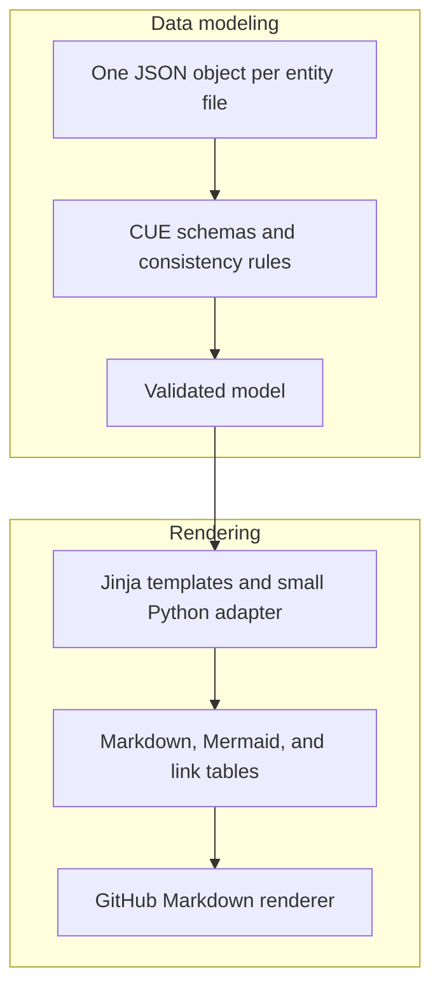

# Solution architecture

[Getting started](../README.md) · [Authoring guide](authoring.md)

This is the implementation of the model-first design agreed during the POCs.
The original experiments and design discussion are preserved in Git history at
the upstream `poc-done` tag. The starter keeps one example of each entity type.

## Principles and technology

Use small established tools for validation, templating, and diagram layout. All
required tools are open source and free for commercial use. The architecture
has two layers:

The model is authoritative. Rendering preserves its identities, relationships,
versions, directions, and response associations. Renderers do not infer which
interface a response belongs to by finding another connection with reversed
endpoints. Python loads files and extracts artifact facts; CUE owns domain
validation. Jinja is now the selected template engine. Python 3.11+ and CUE
v0.17.1 are required; the two Python packages are pinned in requirements.txt.

GitHub renders fenced Mermaid directly. HTML publication, documentation websites,
GitHub Pages, PlantUML, and LikeC4 are outside this implementation. PlantUML's
SVG links become inactive when embedded as ordinary GitHub Markdown images;
Mermaid flowcharts provide the required native-GitHub annotation interaction.

## Files, entities, and source of truth

| Entity | Definition | Actual usage |
| --- | --- | --- |
| System | Identity, description, internal/external boundary | Derived from views |
| Component | Identity, description, parent system | Derived from views |
| Interface | Owning system/component, protocol, available versions and artifacts, optional supported envelopes | Defined only in views |
| Data contract | Reusable message/schema identity, versions, and artifacts | Selected only in view usages |
| View | An ordered scenario or an overview projecting scenarios | The sole authoring location for actual usage |

There is one JSON object per `ID--descriptive-name.json` file under the
corresponding `model/` category. IDs have typed prefixes. All references use IDs,
not names or filenames. Components, interfaces, and data contracts are never
copied into views. A view's steps and annotation links are owned data, not
standalone entities. There is no integration entity, connection catalog, or
second global usage registry. The `schemas/` folder contains CUE rules;
`model/data-contracts/` contains envelope definitions; `contracts/` contains
versioned documentation artifacts.

The loader builds temporary ID-indexed collections from individual files, checks
that JSON/file keys cannot be silently overwritten, and supplies repository-file
and artifact-version facts to CUE. This aggregate is a build input, not another
maintained catalog. CUE checks filename IDs against object IDs.

Canonical generated pages use stable entity IDs. Interface, component, system,
and envelope usage backlinks are derived from scenarios. Available contracts
and supported envelope versions are capabilities, not statements of actual
deployment or consumption.

## Views and renderer projections

Request steps describe a participant calling an interface owned by a system or
component. Event steps describe data from the interface owner to the participant.
Each selects an exact interface version and has plain annotation text and a
list of typed entity/file links. A response references an earlier request and
inherits its interface/version, endpoints, and route.

One scenario generates a Mermaid **flowchart** component map, a Mermaid sequence
diagram, and a numbered Markdown step table. Order determines numbers; stable
local step IDs determine response associations. Multiple occurrences of an
interface keep their individual annotations and refer to the same canonical
page. Overview views reference scenarios and project their usages without
copying definitions or introducing a global execution order.

Flowchart connections contain independently clickable annotation links and
canonical interface/artifact links. Underlines are removed by generated link
styling. Rendering escapes plain text for Mermaid/GitHub preprocessing. Model
fields contain references and text, not authored HTML/CSS. GitHub's current
Mermaid version and security policy ultimately control interactions.

Sequence messages have plain text and generated numbers. The adjacent table
contains their clickable interface, artifact, and annotation links. This is the
accepted response to sequence-message linking limitations. No separate sequence
definition is maintained.

## Routing and independently versioned envelopes

A pass-through router is an ordinary component exposing ordinary interfaces.
Envelope XSDs are independently versioned data contracts. A view usage selects
the target interface/version and optional transport metadata containing a
routing interface/version, envelope contract/version, and envelope scope.
The router and target identities derive from the interfaces' owners.

The routing API version, envelope XSD version, and target API version are three
independent values. The routing interface declares which envelope versions each
API version supports; CUE checks selections against those capabilities. The
model does not invent an exhaustive compatibility matrix tying target versions
to envelopes when the router simply passes the payload through.

The renderer expands one routed usage into caller → router → target, using
`1a`/`1b` hop labels. The response reverses those same hops and retains the
original interface associations. `router-leg` envelope scope applies to the
caller/router exchange; `end-to-end` applies to both hops. The target payload
contract is selected once and retained across the route. The version table
shows the physical interface, target payload, and envelope independently.
See the [authoring examples](authoring.md#routed-usages) for exact fields.

A router's software release would be a fourth, separate deployment value. It is
not inferred from contract versions and is not part of this starter's schema.

## Consistency and artifact checks

CUE enforces closed per-entity schemas; typed parent, owner, participant,
interface, data-contract, and view references; available versions; supported
envelopes; unique local step IDs; and responses to earlier requests. Routing
components must be distinct from the endpoints. Overview references point to
scenarios, preventing recursive overview composition.

The loader supplies file presence and OpenAPI `info.version`/XSD schema-version
facts. CUE checks these against the declared artifacts and versions. Traversal,
URL, fragment, missing-file, and symlink targets are rejected. The build also
checks ordinary repository-local Markdown destinations and generated-file drift.
These checks do not query live systems, infer compatibility, fully validate
OpenAPI semantics, or validate XML instances against XSDs.

The behavioral tests exercise the real CUE executable, including invalid
references and incompatible envelope selections. Renderer tests inspect expanded
routes, stable response association, derived backlinks, view projections, and
independent link destinations. GitHub-hosted navigation remains a useful final
check when GitHub changes its renderer.

## Reproducible generation and publication

Edit model JSON and authored Markdown, validate, generate, and commit both source
and output. Generated pages are clearly marked and owned by the generator.
`check` rejects stale or orphaned generated files. GitHub renders committed
Mermaid source rather than pre-rendered SVG/PNG images.

Normal Markdown links are relative, preserving navigation in branches and
history. Diagram URLs are absolute because GitHub's Mermaid iframe has a
different origin. Generation infers the repository and branch or accepts
explicit overrides. It records this context beside generated pages, so detached
CI checks reproduce the committed output. Forks must regenerate once to update
their diagram URLs. Snapshot/release builds can select a tag or commit as `--ref`.

CI checks source/output consistency and runs the behavioral tests. An explicit
workflow-dispatch action can regenerate and commit pages on the selected branch;
ordinary push/PR checks do not rewrite authors' commits.

## Deliberate limits and extension points

This starter implements linear request/response and event scenarios, one
pass-through router per usage, and overview projection. Multiple independent
versions can be declared and selected in different usages, but environment
deployments and runtime verification are separate future concerns.

Parallel flows, branching, retries, multiple routing hops, payload transformation,
response-specific contract/transport overrides, external annotation URLs, and
fragment targets need explicit future schema extensions. Add domain constraints
in CUE and presentation in templates rather than maintaining duplicate custom
validators or renderer-specific domain models.
