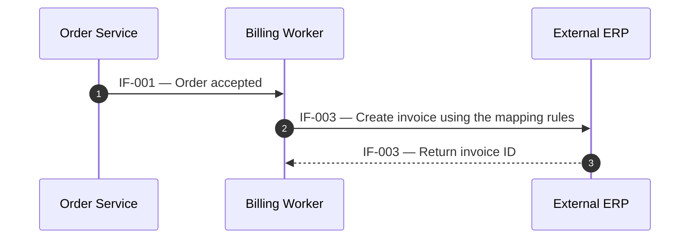

<!-- Generated by scripts/generate.py; edit catalog/catalog.json instead. -->

# Invoice creation

[Full landscape and view index](../../README.md) · [View definition](../../catalog/catalog.json)

From an accepted order to a confirmed ERP invoice, with linked mapping rules and an explicit response.

## Component map

```mermaid
flowchart LR
  subgraph internal["Internal components"]
    S_order_service["Order Service"]:::internal
    S_billing_worker["Billing Worker"]:::internal
  end
  subgraph external["External systems"]
    S_erp["External ERP"]:::external
  end
  STEP_001(["1. IF-001<br/>Order placed event"]):::interface
  S_order_service -->|"1. Order accepted"| STEP_001 --> S_billing_worker
  STEP_002(["2. IF-003<br/>Create invoice"]):::interface
  S_billing_worker -->|"<a href='https://github.com/benedikt-roth/integration-atlas-demo/blob/main/docs/notes/invoice-mapping.md'>2. Create invoice using the mapping rules</a>"| STEP_002 --> S_erp
  STEP_003(["3. IF-003<br/>Create invoice"]):::interface
  S_erp -.->|"3. Return invoice ID"| STEP_003 -.-> S_billing_worker
  click S_order_service href "https://github.com/benedikt-roth/integration-atlas-demo/blob/main/docs/systems/order-service.md" "Open system details" _top
  click S_billing_worker href "https://github.com/benedikt-roth/integration-atlas-demo/blob/main/docs/systems/billing-worker.md" "Open system details" _top
  click S_erp href "https://github.com/benedikt-roth/integration-atlas-demo/blob/main/docs/systems/erp.md" "Open system details" _top
  click STEP_001 href "https://github.com/benedikt-roth/integration-atlas-demo/blob/main/docs/interfaces/IF-001.md" "Open interface details" _top
  click STEP_002 href "https://github.com/benedikt-roth/integration-atlas-demo/blob/main/docs/interfaces/IF-003.md" "Open interface details" _top
  click STEP_003 href "https://github.com/benedikt-roth/integration-atlas-demo/blob/main/docs/interfaces/IF-003.md" "Open interface details" _top
  style internal fill:#eff6ff,stroke:#93c5fd,color:#172554
  style external fill:#f8fafc,stroke:#cbd5e1,color:#111827
  classDef internal fill:#dbeafe,stroke:#2563eb,color:#172554
  classDef external fill:#e5e7eb,stroke:#64748b,color:#111827
  classDef interface fill:#fef3c7,stroke:#d97706,color:#451a03
```

Numbers identify steps in this scenario, not separate interface definitions. Click a yellow
interface node for its canonical details, or a linked connection annotation for its reference page.
Dashed connections are reverse messages on the same interface.

## Sequence diagram

The step list drives numbering in both diagrams. Responses are explicit reverse steps.
Arrows describe this linear data flow; they do not simulate transport timing.
GitHub sequence message labels do not support these annotation hyperlinks; use the linked annotations in the table below.

## Steps and references

| Step | Source → target | Annotation | Interface | Deployed version | Contract artifact |
| --- | --- | --- | --- | --- | --- |
| 1 | [Order Service](../systems/order-service.md) → [Billing Worker](../systems/billing-worker.md) | Order accepted | [IF-001](../interfaces/IF-001.md) | 1.0.0 | [JSON Schema](../../contracts/orders/order-placed-1.0.0.schema.json) |
| 2 | [Billing Worker](../systems/billing-worker.md) → [External ERP](../systems/erp.md) | [Create invoice using the mapping rules](../notes/invoice-mapping.md) | [IF-003](../interfaces/IF-003.md) | 2.1.0 | [OpenAPI 3.1](../../contracts/erp/invoices-2.1.0.openapi.json) |
| 3 | [External ERP](../systems/erp.md) → [Billing Worker](../systems/billing-worker.md) | Return invoice ID | [IF-003](../interfaces/IF-003.md) | 2.1.0 | [OpenAPI 3.1](../../contracts/erp/invoices-2.1.0.openapi.json) |
