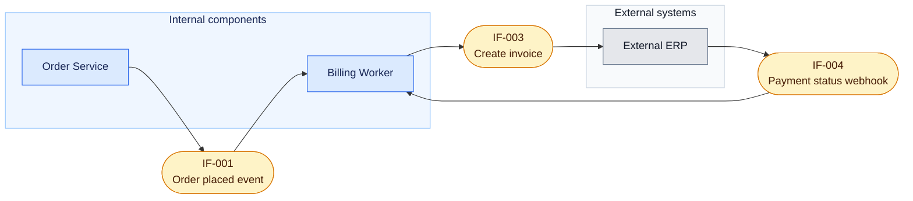

<!-- Generated by scripts/generate.py; edit catalog/catalog.json instead. -->

# Invoicing subdomain

[Full landscape and view index](../../README.md) · [View definition](../../catalog/catalog.json)

Order events, invoice creation, and payment updates, without implying an execution sequence.

## Component map

This overview selects interfaces without implying execution order. Click an interface node for its details.

## Selected interfaces

| Interface | Source → target | Protocol | Deployed version | Contract artifact |
| --- | --- | --- | --- | --- |
| [IF-001 — Order placed event](../interfaces/IF-001.md) | [Order Service](../systems/order-service.md) → [Billing Worker](../systems/billing-worker.md) | AMQP / JSON | 1.0.0 | [JSON Schema](../../contracts/orders/order-placed-1.0.0.schema.json) |
| [IF-003 — Create invoice](../interfaces/IF-003.md) | [Billing Worker](../systems/billing-worker.md) → [External ERP](../systems/erp.md) | HTTPS / REST / JSON | 2.1.0 | [OpenAPI 3.1](../../contracts/erp/invoices-2.1.0.openapi.json) |
| [IF-004 — Payment status webhook](../interfaces/IF-004.md) | [External ERP](../systems/erp.md) → [Billing Worker](../systems/billing-worker.md) | HTTPS / webhook / JSON | 1.2.0 | [JSON Schema](../../contracts/erp/payment-status-1.2.0.schema.json) |
