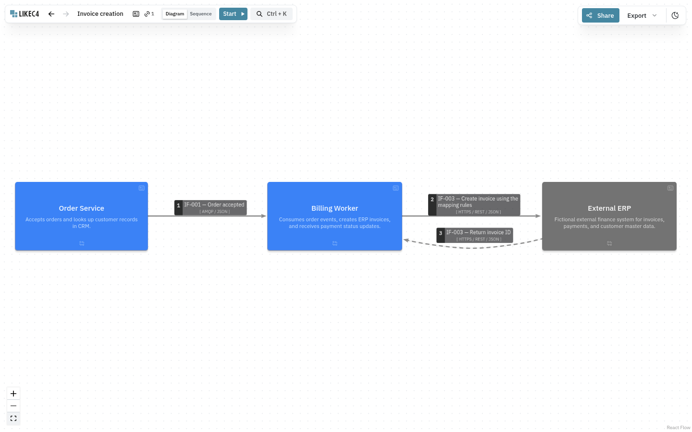
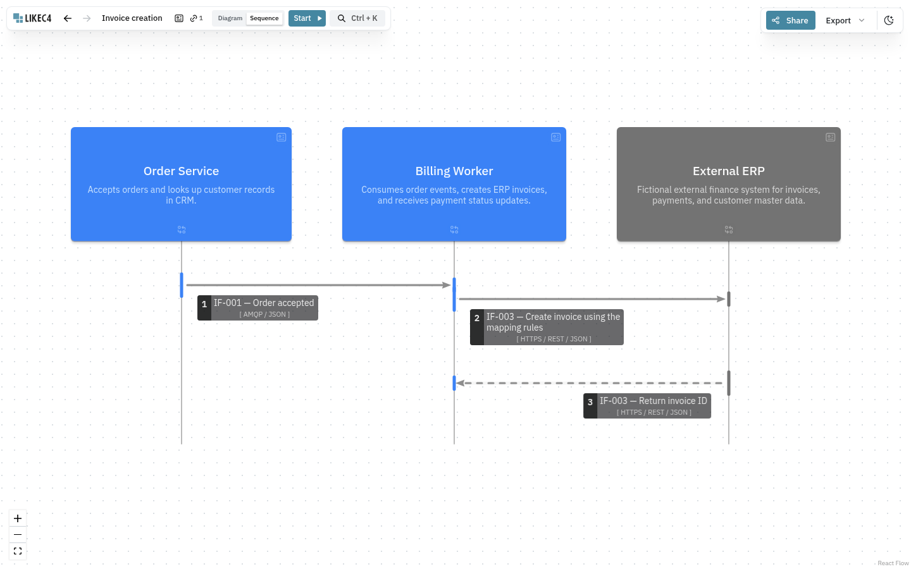
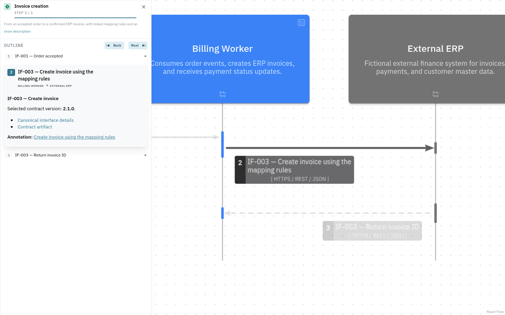

# LikeC4 proof of concept

A runnable [LikeC4](https://likec4.dev/) demonstration alongside the existing
Mermaid implementation. It uses the **same catalog, interfaces, scenarios, and
documentation artifacts**. LikeC4 is pinned to **1.60.0**, released under the
[MIT license](https://github.com/likec4/likec4/blob/main/LICENSE), which permits commercial use.

## Run it

Use Node.js 24 (upstream minimum: 22.22.3) and Python 3.11+.
From the repository root:

```sh
cd likec4-poc
npm ci
npm run validate
npm test
npm run build
npm run preview
```

Open the **local URL printed by the preview command**. The viewer runs locally;
GitHub renders this README and the screenshots, not the interactive `.c4` viewer.
For editing with live diagram reload, use `npm run dev` and open the printed URL
(port 3000). After editing the catalog, rerun `npm run generate` to refresh the
LikeC4 source watched by the viewer.

## Explore the demonstration

Use the view title or the search control (`Ctrl+K`) to navigate. You can also
append these paths to the printed local URL:

| View | Local route | What it demonstrates |
| --- | --- | --- |
| Integration landscape | `#/view/index` | Four systems, five shared interface relationships, and documentation links |
| Invoicing subdomain | `#/view/invoicing_overview` | Only IF-001, IF-003, and IF-004, selected using relationship metadata |
| Invoice creation | `#/view/invoice_creation` | Three numbered steps, including the explicit invoice response |

In **Invoice creation**:

1. Switch between **Diagram** and **Sequence** in the toolbar. Both layouts use
   the same dynamic view; there is one scenario step definition.
2. Click **Start**, then **Next** to reach step 2.
3. In its Markdown notes, click **Create invoice using the mapping rules**. It
   opens the existing [mapping-rules page](../docs/notes/invoice-mapping.md).
4. The same notes provide separate **Canonical interface details** and
   **Contract artifact** links. The return step explicitly links to IF-003 too.
5. Stop the walkthrough and inspect relationships in the full landscape to see
   their selected version, interface ID, owner, and documentation links.

LikeC4 exposes scenario references through clickable **step notes**. The arrow
caption itself is not the direct page hyperlink used in the Mermaid demo.

## Screenshots from the running viewer

The component map:



The sequence layout of the same scenario:



The linked annotation and canonical documentation in step notes:



## One maintained source

```text
../catalog/catalog.json  +  existing docs/ and contracts/
             |
             | scripts/generate.py (small adapter)
             v
        src/atlas.c4
             |
             | LikeC4
             v
     interactive diagrams and static site
```

- [The existing catalog](../catalog/catalog.json) remains the source for
  components, interface metadata, view selection, and scenario steps.
- [The adapter](scripts/generate.py) calls the existing catalog validator and
  generates [readable native LikeC4 DSL](src/atlas.c4). Inspect that source to
  see model elements, typed relationships, filtered views, Markdown notes, and
  the dynamic scenario.
- Interface links point to the existing canonical Markdown pages and versioned
  artifacts on the catalog's configured GitHub branch. No documentation pages
  or contract artifacts are copied into this folder.
- Each interface gets a relationship kind and metadata containing its stable
  ID and selected version. Scenario captions, notes, and URLs are generated from
  the original steps and interface references.

To update the demo after changing the catalog:

```sh
npm run generate
npm run validate
npm test
npm run build
```

`generate:check` rejects stale generated DSL. `validate` runs the native LikeC4
validator with zero warnings allowed. `test` exports LikeC4's actual computed
model and checks its systems, relationships, versions, filtered membership,
ordered flows, response direction, Markdown notes, and explicit documentation
destinations against the catalog.

## Evaluation finding: reverse-step relationship matching

**This is a demonstration, not yet a complete replacement for the Mermaid POC.**

In LikeC4 1.60.0, the native return syntax `billing_worker <- erp` looks up the
model relationship in the actual ERP → Billing Worker direction. Because IF-004
is a separate webhook in that direction, the native return edge associates with
**IF-004**, even though this scenario step is the response on **IF-003**.

The generated return caption, protocol, description, and explicit notes links
are taken from IF-003 and remain correct. However, the native edge's underlying
relationship association is different. Use the explicit canonical link in the
step notes; native relationship exploration is not a reliable interface identity
for this return step.

The verification command reports this as **KNOWN LIKEC4 LIMITATION** instead of
silently claiming the native association is correct. A future migration must
resolve or account for it, particularly when the same pair of systems uses
multiple interfaces. The adapter does not add a duplicate reverse interface to
hide this issue.

## Build artifact and verification

The **Check LikeC4 demonstration** GitHub Actions workflow validates and builds
the demo, then attaches a downloadable **likec4-demo-site** artifact to the run.
It does not publish a website. To serve an extracted artifact, run
`python3 -m http.server 3000` inside its extracted directory and open
`http://localhost:3000/`; hash-based navigation works with a plain static server.

Browser verification used local Chromium to check layout switching, the three
numbered interactions, filtered view membership, and the interface, artifact,
and annotation destinations exposed in the step notes. The screenshots show
that running viewer. The existing Mermaid documentation and tests continue to
run independently.
